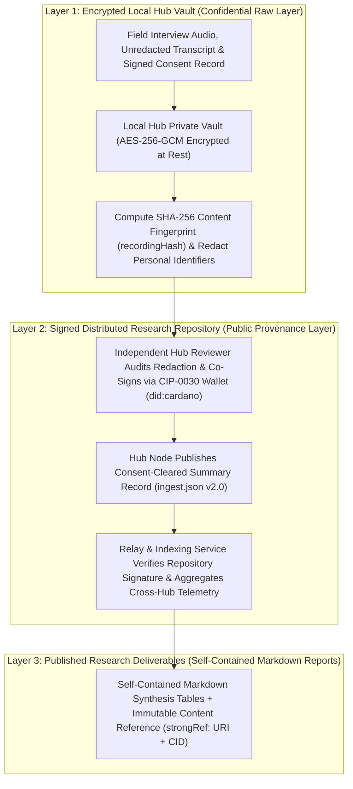

# Data Ingestion Schema and Fieldwork Verification Protocol

This specification defines the Phase 2-3 interview ingestion schema (`ingest.json` v2.0) and the cross-hub verification workflow that govern primary data collection during Phase 3 fieldwork (Weeks 7-12), extending the Milestone 1 [Ingest](../milestone-1/research-design-document/interview-guide/ingest.md), [Verify](../milestone-1/research-design-document/interview-guide/verify.md), and [Conduct](../milestone-1/research-design-document/interview-guide/conduct.md) methodology .

The protocol ensures that every stakeholder interview conducted across the three active emerging-market Regional Hubs (**Buenos Aires Hub**, **Lagos Hub**, and **Nairobi Hub**, operating with `3 Local Project Teams per hub = 9 Local Teams` total) maps directly to the eight research Decision Gates while protecting human-subject privacy under applicable national data protection statutes (`Nigeria NDPA 2023`, `Kenya DPA 2019 s. 40`, `Argentina Law 25.326`, and `EU GDPR`).

---

## 1. Methodological Objectives for Phase 3 Data Governance

Before initiating primary interviews in Week 7, the research team finalized two structural enhancements to the Milestone 1 data ingestion pipeline:

1. **End-to-End Decision-Gate Traceability:** The Milestone 1 base ingestion schema (`ingest.json`) has been expanded so that every verified interview record explicitly captures findings across all eight research Decision Gates (`Gate 1: Regions`, `Gate 2: Use cases`, `Gate 3: Counterparties`, `Gate 4: Regulation`, `Gate 5: Infrastructure`, `Gate 6: Delivery model`, `Gate 7: Adoption`, and `Gate 8: Cross-RFP handoffs`), alongside paired regulatory certainty ratings, local legal counsel triggers, five-tier counterparty access progression, eight-category infrastructure ratings, and four-tier `CASS` adoption signal evaluations.
2. **Uniform Cross-Hub Verification Standards:** A standardized six-step quality-assurance and cryptographic co-signing workflow applies across all three participating regional hubs (**Buenos Aires Hub**, **Lagos Hub**, and **Nairobi Hub**) and their nine Local Project Teams, ensuring consistent role separation, personal-data redaction, and inter-rater calibration throughout Phase 3.

---

## 2. Three-Layer Privacy and Provenance Architecture

The research data infrastructure  separates confidential raw human-subject material, public cryptographic provenance, and self-contained research deliverables into three distinct operational layers:



### Key Architectural Controls Across the Three Layers

| Architectural Control | Technical Mechanism  | Governance & Privacy Function During Phase 3 Fieldwork (`Weeks 7-12`) |
| :--- | :--- | :--- |
| **1. Standard Repository Synchronization** | Regional hub Personal Data Servers (`PDS`) synchronize signed records through a standard AT Protocol relay and indexing pipeline into a unified research aggregation service (`AppView`). | Ensures that every record mutation is cryptographically verified against the regional hub or field team's Decentralized Identifier (`DID`) signing key prior to indexing . |
| **2. Research Lexicon Schemas (`events.prisma.*`)** | Structured JSON Lexicon schemas (`events.prisma.hub.profile`, `events.prisma.hub.deployment`, `events.prisma.hub.team`, and `events.prisma.evidence.interview`, keyed by the recording's `sha256` fingerprint with `text`, `consentScope`, `topic`, `media`, `recordedAt`, `authorDid`, and `createdAt`) paired with the structured analytical template (`ingest.json` v2.0). | Enforces automated schema validation at repository publishing time while keeping raw media and non-public drafts inside the encrypted vault. |
| **3. Dual Identity Binding (`did:plc` / `did:web` + `did:cardano`)** | Self-certifying `did:cardano:stake1...` identifiers verified via Bech32 stake-address parsing, `Ed25519` public-key extraction from `CIP-0030` / `CIP-0008` `COSE_Sign1` signatures, and `Blake2b-224` key-hash matching. | Binds each regional hub (**Buenos Aires**, **Lagos**, **Nairobi**) and independent reviewer to both a repository `DID` and a verifiable Cardano stake keypair. |
| **4. Resilient Field Connectivity** | Regional hub servers operate over standard HTTPS (`port 443`) tunnels with per-`DID` event serialization and repository-status health checks. | Enables field researchers in Lagos, Nairobi, and Buenos Aires to operate sovereign hub nodes reliably across variable local network conditions. |
| **5. Confidential Local Vault & Four-Choice Consent Filtering** | Private per-team blob storage encrypted at rest (`HKDF-SHA256` per-repo keys) with local Whisper transcription, regex and local-model identifier flagging, and four structured consent choices (`1. Private` [safe default, vault only], `2. Research` [anonymous, CPC and authorised researchers only, vault only], `3. Anonymous public` [redacted quotes and findings, published to repo with `consentScope: "anonymous"`], and `4. Public, named` [participant-approved named statements, published to repo with `consentScope: "public"`]), plus a separate `AI training` consent dial (`No` by default). | **Raw interview audio, video, unredacted transcripts, personal names, and private contact details never leave the encrypted local vault.** Every uploaded interview remains strictly `Private` inside the vault until human redaction review is completed; `Private` and `Research` records are never written to an AT Protocol repository. |
| **6. Deterministic Retraction, Backup Purge & Deferred Batch Anchoring** | Every participant receives a withdrawal reference code (`e.g. WA-LOS-REG-02`) before recording begins. Withdrawal removes records from the hub vault, purges `at-pds` CAR backups, and propagates repository tombstones (`uri, cid, rev`), with a mandatory 12-month deletion ceiling on all raw media. `CIP-0020` Cardano batch anchoring (`label 199675`) runs asynchronously at post-review milestone checkpoints after records clear vault review, rather than blocking day-one vault intake. | Guarantees compliance with statutory data-suppression and erasure rights under `Nigeria NDPA 2023`, `Kenya DPA 2019`, `Argentina Law 25.326`, and `EU GDPR`. |

---

## 3. Repository Publication Record (`events.prisma.evidence.interview`) and Analytical Coding Schema (`ingest.json` v2.0)

In accordance with the vault-first privacy architecture, data capture separates the **minimal public repository record** (`events.prisma.evidence.interview`, published to the team's `at-pds` repository *only* when the participant selects **Choice 3: `Anonymous public`** or **Choice 4: `Public, named`** and a hub lead approves the redacted text on `/review`) from the **structured analytical coding template** (`ingest.json` v2.0, which structures the approved `text` summary and the vault-side research synthesis across all eight Decision Gates).

### 3.1 Wire-Level AT Protocol Lexicon Record (`events.prisma.evidence.interview`)

When a reviewed interview is approved for repository publication (`consentScope: "anonymous"` or `"public"`), the vault writes an `events.prisma.evidence.interview` record using the reviewer's authenticated `at-pds` session, keyed by the vault recording's `sha256` fingerprint:

```json
{
  "$type": "events.prisma.evidence.interview",
  "text": "[Approved redacted interview summary and structured Decision-Gate findings - up to 30,000 chars / 10,000 graphemes]",
  "consentScope": "anonymous | public",
  "topic": "interview",
  "media": {
    "sha256": "e3b0c44298fc1c149afbf4c8996fb92427ae41e4649b934ca495991b7852b855",
    "mimeType": "audio/ogg",
    "kind": "voice"
  },
  "recordedAt": "2026-11-24T10:00:00Z",
  "authorDid": "did:cardano:stake1u8examplereviewerstakekeyhash...",
  "createdAt": "2026-11-25T16:30:00Z"
}
```

> **Vault-Only Boundary for `Private` and `Research` Records:** Interviews where the respondent selects **Choice 1 (`Private`)** or **Choice 2 (`Research` - readable only by the CPC and authorised project researchers)** remain encrypted inside the hub's local vault (`apps/vault`) and are never written as `events.prisma.evidence.interview` records to the public AT Protocol repository.

### 3.2 Structured Analytical Coding Schema (`ingest.json` v2.0)

The JSON schema below is the Phase 2-3 analytical superset of the Milestone 1 [Ingest](../milestone-1/research-design-document/interview-guide/ingest.md) specification. It retains all five Milestone 1 top-level blocks (`conduct`, `participant`, `metadata`, `business_value`, `evidence`) for full backward compatibility while aligning consent fields with the four-choice vault model (`private`, `research`, `anonymous`, `public`) and `events.prisma.evidence.interview`:

```json
{
  "$schema": "https://json-schema.org/draft/2020-12/schema",
  "title": "PRISMA Phase 2-3 Interview Ingest and Decision-Gate Traceability Schema (v2.0)",
  "lexicon_nsid": "events.prisma.evidence.interview",
  "hub_profile_lexicon": "events.prisma.hub.profile",
  "hub_team_lexicon": "events.prisma.hub.team",
  "schema_version": "2.0.0",
  "provenance": {
    "record_strongRef": {
      "uri": "at://did:plc:exampleteamdid/events.prisma.evidence.interview/e3b0c44298fc1c149afbf4c8996fb92427ae41e4649b934ca495991b7852b855",
      "cid": "bafyreig7x4z2m9c22p5q8w3v6n4r8k2j5h7g9f1d3s5a7q9w2e4r6t8y0u"
    },
    "hub_did_plc": "did:plc:examplehubpds",
    "hub_did_cardano": "did:cardano:stake1u9examplecardanostakekeyhash...",
    "team_did_plc": "did:plc:exampleteamdid",
    "authorDid": "did:cardano:stake1u8examplereviewerstakekeyhash...",
    "media": {
      "sha256": "e3b0c44298fc1c149afbf4c8996fb92427ae41e4649b934ca495991b7852b855",
      "mimeType": "audio/ogg",
      "kind": "voice | video | file | text"
    },
    "verification_status": "vault_private | pending_review | verified_published | disputed | withdrawn",
    "recordedAt": "2026-11-24T10:00:00Z",
    "createdAt": "2026-11-25T16:30:00Z"
  },
  "conduct": {
    "withdrawal_reference_code": "WA-LOS-PAY-01",
    "play_id": "H1 | H2 | H3 | H4 | H5 | H6 | H7 | H8 | H9 | H10 | H11 | H12 | H13 | H14 | H15",
    "use_case": "Remittances | Identity_Credentials | Land_Records | Ag_Supply_Chain | Stablecoin_Settlement | Public_Procurement_Audit",
    "question_pack": "public-sector | regulators-policy | humanitarian-ngo | delivery-partners | payment-infrastructure | agricultural-networks | cardano-ecosystem",
    "screener_passed": true,
    "consent_choice": "private | research | anonymous_public | public_named",
    "consentScope": "anonymous | public",
    "ai_training_consent": false,
    "recording_mode": "recorded_vault_encrypted | notes_only | text_intake",
    "consent_recorded_before_start": true,
    "anonymous": true,
    "re_contact": false,
    "lead_interviewer_role_separated_from_introducer": true
  },
  "participant": {
    "id": "NG-LAG-001",
    "counterparty_register_id": "CP-WA-03",
    "stakeholder_category": "1_public_sector | 2_regulators_policy | 3_humanitarian_ngo | 4_delivery_partners | 5_payment_infrastructure | 6_agricultural_networks | 7_cardano_ecosystem",
    "functional_role": "R1_Decision_Sponsor | R2_Regulatory_Gatekeeper | R3_Procurement_Budget_Owner | R4_Local_Delivery_Partner | R5_Distribution_Trust_Partner | R6_Technical_Compliance_Enabler",
    "cardano_affiliation": "non_cardano | cardano_adjacent | cardano_insider",
    "ecosystem_relationship_tag": "IND-COLD | PRISMA-HUB | CATS26-WARM | WADA-NET | CARDANO-ECO",
    "coi_flag": false,
    "coi_disclosure": "None - independent SEC ARIP licensed VASP operating on Tron and EVM rails."
  },
  "metadata": {
    "date_time": "2026-11-24T10:00:00Z",
    "country": "Argentina | Uruguay | Paraguay | Nigeria | Ghana | Senegal | Kenya | Rwanda | Uganda | Spain | Brazil | Colombia | Peru | Mexico | Ethiopia",
    "region": "Southern Cone | West Africa | East Africa | Iberia | Brazil | Andean | Mexico | Horn_Ethiopia",
    "hub_anchor": "Buenos Aires Hub | Lagos Hub | Nairobi Hub | Desk Monitor",
    "language": "en | es | fr | sw | pt",
    "stakeholder": "Anonymised Institutional Archetype Label (e.g. SEC Nigeria ARIP-Licensed VASP Settlement Desk)",
    "interviewer": "Hub Team ID (e.g. LAG-TEAM-01)",
    "independent_reviewer": "Hub Reviewer ID (e.g. LAG-REV-01)"
  },
  "decision_gates": {
    "gates_addressed": [
      "Gate 1: Regions",
      "Gate 2: Use cases",
      "Gate 3: Counterparties",
      "Gate 4: Regulation",
      "Gate 5: Infrastructure",
      "Gate 6: Delivery model",
      "Gate 7: Adoption",
      "Gate 8: Cross-RFP handoffs"
    ],
    "primary_gate_findings": {
      "gate_1_regions": "Validates or revises cluster RARF score across D1-D10.",
      "gate_2_use_cases": "Tests specific falsification threshold for play_id (H1-H15).",
      "gate_3_counterparties": "Upgrades counterparty access_basis from Warm/Referred/Desk to Interviewed.",
      "gate_4_regulation": "Verifies LC-01 to LC-10 statutory and compliance questions.",
      "gate_5_infrastructure": "Rates the 8 prerequisite categories (Met / Partially Met / Unmet / Unknown / Dependent).",
      "gate_6_delivery_model": "Evaluates local SI SLA capacity and 6-role partnership completeness.",
      "gate_7_adoption": "Identifies hard falsification or No-Go triggers.",
      "gate_8_cross_rfp_handoffs": "Logs external protocol/liquidity dependencies (HO-M2-01 to HO-M2-05)."
    },
    "play_status_after_call": "confirmed | revised | contested-weak | rejected | inconclusive",
    "rarf_dimensions_tested": ["D1", "D2", "D3", "D4", "D5", "D6", "D7", "D8", "D9", "D10"]
  },
  "business_value": {
    "use_case": "",
    "adoption": "",
    "commercial": "",
    "market_access": "",
    "deployment": "",
    "incumbent_baseline_named": "e.g. NIBSS NIP + Tron TRC-20 USDT OTC desks",
    "why_cardano_vs_centralised_db_or_competing_chain": "Explicit operational comparison captured from respondent."
  },
  "counterparty_lead": {
    "archetype_or_entity_code": "CP-WA-03",
    "functional_role": "R6_Technical_Compliance_Enabler",
    "access_basis_before_call": "Warm Access | Referred | Desk-Identified | Hypothetical",
    "access_basis_after_call": "Interviewed",
    "reachability_12_24m": "High | Medium | Low",
    "referral_captured": false,
    "referral_permission_granted": false
  },
  "regulatory_finding": {
    "jurisdiction": "Nigeria",
    "local_counsel_trigger_id": "LC-03",
    "competent_authorities": ["SEC Nigeria", "Central Bank of Nigeria (CBN)"],
    "statutory_citations": ["Investments and Securities Act 2025 (ISA 2025)", "CBN Circular FPR/DIR/PUB/CIR/002/003 (2023-12-22)"],
    "regulatory_certainty_paired": "Clear (High Certainty) | Evolving (Medium Certainty) | Uncertain (Low Certainty)",
    "specialist_local_counsel_required": "Yes - Mandatory Before Pilot | Conditional - Required for Licensing/Tender | No - Standard Compliance Only",
    "counsel_trigger_rationale": ""
  },
  "infrastructure_assessment": {
    "stablecoin_liquidity": "Met | Partially Met | Unmet | Unknown | Dependent on Another Workstream",
    "local_off_ramp": "Met | Partially Met | Unmet | Unknown | Dependent on Another Workstream",
    "wallet_ux_abstraction": "Met | Partially Met | Unmet | Unknown | Dependent on Another Workstream",
    "mobile_first_offline_ussd": "Met | Partially Met | Unmet | Unknown | Dependent on Another Workstream",
    "privacy_selective_disclosure": "Met | Partially Met | Unmet | Unknown | Dependent on Another Workstream",
    "identity_kyc_integration": "Met | Partially Met | Unmet | Unknown | Dependent on Another Workstream",
    "local_delivery_capacity": "Met | Partially Met | Unmet | Unknown | Dependent on Another Workstream",
    "compliance_sla_artifacts": "Met | Partially Met | Unmet | Unknown | Dependent on Another Workstream"
  },
  "adoption_signal": {
    "signal_present": false,
    "cass_signal_id": "CASS-M2-05",
    "signal_description": "",
    "evidence_type": "Primary_Observation | Documentary_Contract | Third_Party_Independent | Unverified_Assertion",
    "proposed_cass_tier": "Tier 1: Verified Adoption Signal | Tier 2: Strong Opportunity Signal | Tier 3: Moderate / Exploratory Signal | Tier 4: Weak / Cosmetic Signal",
    "cass_rationale": "",
    "prior_community_claim_reclassified": false
  },
  "cross_rfp_handoff": {
    "handoff_triggered": true,
    "handoff_id": "HO-M2-01",
    "target_rfp": "RFP-01_Liquidity_Stablecoins | RFP-02_Impact_Framework | RFP-03_Enterprise_Compliance | RFP-06_Developer_Ecosystem | RFP-07_Interoperability | None",
    "blocker_summary": "",
    "requested_receiving_action": ""
  },
  "evidence": {
    "observation": "",
    "counterevidence_or_limitation": "",
    "source": "Primary_Interview | Secondary_Statutory | Secondary_Institutional | Community_Self_Report",
    "confidence": "High (Triangulated Primary) | Medium (Single Primary or Convergent Secondary) | Low (Desk Estimate or Unverified Claim)"
  }
}
```

### Schema-to-Deliverable Traceability Mapping

| `ingest.json` v2.0 Block | Milestone 1 Design Specification | Phase 2 Baseline Deliverable | Downstream Phase 3-5 Analytical Output |
| :--- | :--- | :--- | :--- |
| **`provenance`** (`record_strongRef`, `hub_did_plc`, `hub_did_cardano`, `recordingHash`, `verification_status`) | [Ingest](../milestone-1/research-design-document/interview-guide/ingest.md) & [Verify](../milestone-1/research-design-document/interview-guide/verify.md) | [Data Ingestion Schema and Fieldwork Verification Protocol](./phase-2-schema-and-protocol-update.md) | Links each Milestone 3 synthesis table and Milestone 4-5 Playbook recommendation to a content-addressed `at:// URI + CID` and `SHA-256` vault digest. |
| **`decision_gates`** (`gates_addressed`, `primary_gate_findings`, `play_status_after_call`, `rarf_dimensions_tested`) | [Decision Gates](../milestone-1/research-design-document/decision-gates.md) (`Gates 1-8`) | [Regional Market Prioritisation Matrix](./market-prioritisation-matrix.md) & [Use-Case Viability Register](./desk-research-and-use-case-scan.md) | Drives post-interview RARF re-scoring (`D1-D10`) and final hypothesis disposition (`confirmed`, `revised`, `rejected`) in Milestones 3 and 4. |
| **`counterparty_lead`** (`archetype_or_entity_code`, `functional_role`, `access_basis_before_call`, `access_basis_after_call`) | [Stakeholder Recruitment Plan](../milestone-1/research-design-document/stakeholder-recruitment-plan.md) | [Stakeholder Ecosystem and Counterparty Mapping Report](./counterparty-access-map.md) | Tracks progression from `Warm Access`, `Referred`, or `Desk-Identified` to `Tier 1: Interviewed` across all six functional roles (`R1-R6`). |
| **`regulatory_finding`** (`local_counsel_trigger_id`, `regulatory_certainty_paired`, `specialist_local_counsel_required`) | [Regulators Question Pack](../milestone-1/research-design-document/question-packs/regulators.md) | [Preliminary Regulatory and Compliance Scan](./regulatory-preliminary-scan.md) (`LC-01` to `LC-10`) | Feeds the Primary-Verified Regulatory and Compliance Matrix in Milestones 4 and 5. |
| **`infrastructure_assessment`** (8 categories rated `Met` / `Partially Met` / `Unmet` / `Unknown` / `Dependent`) | [Adoption Readiness](../milestone-1/research-design-document/adoption-readiness.md) | [Regional Market Prioritisation Matrix](./market-prioritisation-matrix.md) (`Section 5`) | Feeds the Infrastructure Prerequisite and Gap Assessment in Milestones 4 and 5. |
| **`adoption_signal`** (`cass_signal_id`, `proposed_cass_tier`, `prior_community_claim_reclassified`) | [Adoption Signals](../milestone-1/research-design-document/adoption-signals.md) (`CASS Tiers 1-4`) | [Use-Case Viability Register](./desk-research-and-use-case-scan.md) (`Section 6`) | Governs whether a regional signal advances from `Tier 3` to `Tier 2` or `Tier 1` following independent primary verification. |
| **`cross_rfp_handoff`** (`handoff_id`, `target_rfp`, `blocker_summary`, `requested_receiving_action`) | [Decision Gates](../milestone-1/research-design-document/decision-gates.md) (`Gate 8`) | [Regional Market Prioritisation Matrix](./market-prioritisation-matrix.md) (`Section 6`) | Routes validated ecosystem dependencies to portfolio workstreams (`RFP 01`, `RFP 02`, `RFP 03`, `RFP 06`, `RFP 07`, `RFP 08`) in Milestones 4 and 5. |

---

## 4. Six-Step Cross-Hub Fieldwork Verification Checklist

To ensure that every interview conducted in the **Buenos Aires Hub**, **Lagos Hub**, and **Nairobi Hub** (`9 Local Project Teams` total) meets identical evidentiary, privacy, and bias-control standards, field teams execute the six-step verification checklist in Table 2 for each session prior to counting it toward the Phase 3 sample quota.

| Step | Workflow Stage | Operational Requirement Across All Regional Hubs | Technical Verification Mechanism |
| :-: | :--- | :--- | :--- |
| **1** | **Pre-Call `Assemble` & Screener Check** | Prior to each interview, the lead interviewer populates the six-row `Assemble` header (`Cluster`, `Use case`, `Play one-liner`, `Hypothesis status`, `Desk claims to test`, `What would falsify this play`) from the [Use-Case Viability Register](./desk-research-and-use-case-scan.md) and confirms that the participant satisfies the Question Pack Screener (`screener_passed: true`). | Recorded in `conduct.play_id`, `conduct.question_pack`, and `conduct.screener_passed`. |
| **2** | **Role Segregation & Blockchain-Agnostic Discovery** | Where a participant was introduced through a regional hub, `Wada`, or `CATS26` contact (`PRISMA-HUB`, `CATS26-WARM`, `WADA-NET`, `CARDANO-ECO`), the person who made the introduction does not serve as sole lead interviewer or final verifier (`lead_interviewer_role_separated_from_introducer: true`). The first `60%` of the session focuses on blockchain-agnostic operational problem and incumbent-system discovery. | Verified through distinct `metadata.interviewer` and `metadata.independent_reviewer` identifiers and `provenance.reviewer_did_cardano`. |
| **3** | **Informed Consent & Encrypted Vault Upload (`Within 48h`)** | Consent is confirmed and logged before recording begins (`conduct.consent_recorded_before_start: true`), and the participant receives a withdrawal reference code. Raw audio and unredacted transcripts are uploaded exclusively to the hub's encrypted local vault (`apps/vault`, `Private` by default), which computes the `SHA-256` `media.sha256` fingerprint. | The local vault blocks unauthenticated external reads; raw files and `Private` or `Research` interviews are never published to the public repository. |
| **4** | **Personal-Data Redaction & Structured Coding (`Within 48h`)** | Local Whisper transcribes the recording and local rules and model flag personal names, third-party names, phone numbers, emails, and indirect identifiers. The interviewer and reviewer remove all flagged identifiers (unless the participant chose `Public, named` / `consentScope == "public"`) and complete the structured Decision-Gate blocks, including `business_value.incumbent_baseline_named` and `evidence.counterevidence_or_limitation`. | The vault review screen (`/review`) refuses an `anonymous` approval while any detected phone number, email, link, or unredacted identifier remains visible. |
| **5** | **Independent Hub Peer-Review & Repository Publication (`Within 72h`)** | A Hub Lead or designated reviewer compares the encrypted vault draft against the redacted summary to confirm that: (a) all personal data and third-party names are redacted; (b) courtesy statements are not miscoded as `CASS Tier 1` or `Tier 2`; and (c) counterevidence is accurately captured. For `Anonymous public` (`consentScope: "anonymous"`) and `Public, named` (`consentScope: "public"`) records, the reviewer signs in with their `at-pds` wallet session (`authorDid: did:cardano:stake1...`) to write `events.prisma.evidence.interview`. | Cryptographic signature verification writes the approved record to the team repository, keyed by `media.sha256`, and generates the immutable `strongRef` (`at:// URI + CID`). `CIP-0020` Cardano batch anchoring follows asynchronously at post-review batch checkpoints. |
| **6** | **Aggregation Indexing & Weekly Calibration Audit** | The indexing service verifies the repository signature and aggregates the record into the cross-hub research view. During weekly calibration reviews in Weeks 7-12, the Principal Investigator and Project Director audit sample records across all hubs to maintain inter-rater consistency on RARF and CASS ratings. | Idempotent `(uri, cid, rev)` indexing tracks regional quota completion and category balance in real time . |
